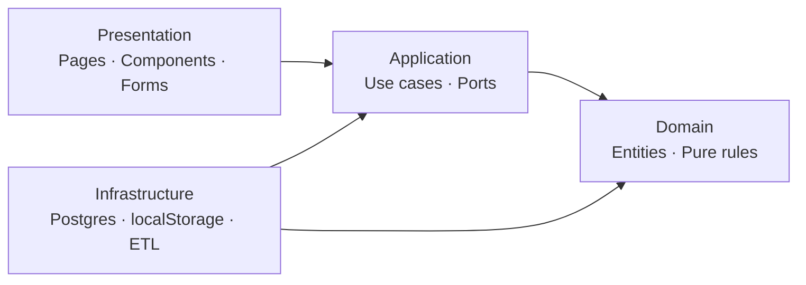

# RenalTable 아키텍처

- 상태: Phase 0 제안
- 기준일: 2026-11-01

## 1. 결정 요약

초기 제품은 하나의 Next.js 애플리케이션과 하나의 PostgreSQL 데이터베이스로 구성한 모듈형 모놀리스다. 프로필과 식단은 브라우저에, 검토된 공개 식품·레시피·콘텐츠는 서버 DB에 둔다. 외부 공공 API는 사용자 요청 경로에서 직접 호출하지 않고 별도 가져오기 작업을 거쳐 검증된 내부 데이터만 제공한다.

## 2. 기술 스택

| 영역 | 선택 | 근거와 제약 |
| --- | --- | --- |
| Runtime | Node.js 24 LTS | Node 공식 정책은 운영에 LTS 사용을 권장한다. 로컬 26은 사용 가능하지만 프로젝트/CI는 24로 고정한다. |
| Web | Next.js 16.x App Router | 16은 현재 Active LTS다. Server Components와 route handler를 한 배포 단위에서 사용한다. |
| UI | React 19.x, TypeScript 5.9 strict | Next 16과 호환되는 패치 버전을 Phase 1 lockfile로 고정한다. |
| CSS | Tailwind CSS 4.x | 작은 디자인 토큰 층과 접근 가능한 자체 컴포넌트를 사용한다. |
| DB | PostgreSQL, Supabase 후보 | 표준 관계형 무결성과 검색/집계에 적합하다. Supabase Free는 500 MB DB, 휴면 일시중지 등 운영 제약이 있어 후보일 뿐이다. |
| ORM | Drizzle ORM + SQL migration | SQL에 가까운 타입 안전 API와 검토 가능한 SQL 마이그레이션을 제공한다. Prisma보다 생성 계층이 얇고 ETL/제약식 제어가 직접적이다. |
| Unit/Integration | Vitest 5 + Testing Library | Vitest 5는 Node 22.12+가 필요하며 Node 24 기준과 맞는다. |
| E2E | Playwright | Chromium/WebKit/Firefox와 모바일 에뮬레이션을 한 도구로 검증한다. |
| CI | GitHub Actions | 저장소와 통합되고 MVP에 별도 유료 CI가 필요 없다. |
| Hosting | Vercel Hobby 우선 후보 | 비공개 Git 저장소를 유지하면서 Next.js를 무료 배포하기 단순하다. 개인·비상업 용도와 무료 한도 내에서만 사용하고 초과 시 서비스가 일시 중지될 수 있다. |

공식 근거:

- [Next.js 지원 정책](https://nextjs.org/support-policy)
- [Node.js 릴리스 정책](https://nodejs.org/en/about/previous-releases)
- [React 버전](https://react.dev/versions)
- [Tailwind의 Next.js 설치 가이드](https://tailwindcss.com/docs/installation/framework-guides/nextjs)
- [Vitest 시작 가이드](https://vitest.dev/guide/)
- [Playwright 설치/지원 환경](https://playwright.dev/docs/intro)
- [Drizzle 개요](https://orm.drizzle.team/docs/overview)
- [Supabase 요금과 한도](https://supabase.com/docs/guides/platform/billing-on-supabase)
- [Vercel 요금제 조건](https://vercel.com/pricing)

정확한 패치 버전은 Phase 1 초기화 당일 공식 릴리스와 보안 공지를 다시 확인하고 lockfile에 기록한다.

## 3. 논리 구조

```text
src/
  app/                 Next.js page, layout, route handler
  modules/
    foods/
      domain/          Food, NutrientAmount, completeness rules
      application/     search/get use cases and ports
      infrastructure/  Drizzle repository, import adapters
      presentation/    feature UI and view models
    recipes/           같은 네 층
    profile/           domain + browser persistence adapter
    planner/           aggregation, shopping list, browser persistence
    guide/             reviewed content read model
  shared/
    domain/             unit, quantity, result primitives
    infrastructure/     db, validation, logging
    ui/                 accessible design-system primitives
```

폴더는 Phase 1 구현 시 실제 복잡도에 맞춰 최소 단위로 시작한다. 비어 있는 추상 계층은 미리 만들지 않는다.

## 4. 의존 방향



- Domain은 React, Next.js, Drizzle, `window`를 import하지 않는다.
- Application은 repository/storage 인터페이스를 정의한다.
- Infrastructure가 인터페이스를 구현하고 composition root에서 단순 함수 인자로 주입한다.
- 복잡한 DI 컨테이너는 사용하지 않는다.

## 5. 실행 경계

### 서버

- 공개 식품·레시피·가이드 조회
- 검색, 페이지네이션, 출처 조합
- 결정적 영양 계산 API가 필요할 경우 입력 검증 후 도메인 함수 호출
- ETL은 사용자 요청과 분리된 명시적 관리 작업/CI 수동 workflow로 실행

### 브라우저

- 건강 프로필, 영양 목표, 주간 식단, 장보기 체크 상태 저장
- UI 입력 검증과 서버에서 받은 공개 데이터 조합
- 저장 형식에 `schemaVersion`을 두고 실패 시 안전한 초기화/내보내기 안내 제공

### 금지 경계

- 공공 API 키를 브라우저에 노출하지 않는다.
- 프로필을 URL, 로그, 분석 이벤트, 오류 추적 payload에 포함하지 않는다.
- 외부 공공 API 응답을 검증 없이 사용자에게 중계하지 않는다.

## 6. 주요 흐름

### 식품 가져오기

`Source fetch → immutable raw snapshot → schema validation → normalization → dedup candidate report → reviewer approval → transactional publish`

### 레시피 영양 계산

`Recipe ingredients → food nutrient observations → unit conversion → per-nutrient sum → completeness + provenance → versioned result`

### 추천

`local profile → allergy/exclusion hard filter → data completeness gate → user target comparison → deterministic ranking → Korean explanation`

추천 설명은 계산 결과를 템플릿으로 표현하며 생성형 AI를 계산 경로에 넣지 않는다.

## 7. 렌더링과 캐시

- 홈과 가이드는 정적 생성/재검증을 우선한다.
- 식품·레시피 검색은 서버 조회와 URL search params를 사용한다.
- 건강 프로필이 포함된 결과는 공용 CDN 캐시 키에 넣지 않는다.
- DB 게시 버전 변경 시 태그 기반 재검증을 고려한다.

## 8. PWA 확장점

Phase 1에는 manifest와 설치 기능을 필수로 넣지 않는다. 브라우저 저장소 adapter, 반응형 shell, 아이콘 규격을 분리해 Phase 5 이후 service worker를 추가할 수 있게 한다. 의료/영양 데이터의 오래된 오프라인 캐시는 갱신일과 함께 표시해야 한다.

## 9. 운영·비용 제약

- Supabase Free 프로젝트는 사용량과 휴면 정책 때문에 공개 서비스의 가용성을 보장하지 않는다.
- Vercel Hobby는 개인·비상업 용도다. 프로젝트 운영 주체가 달라지면 Pro 또는 다른 호스팅을 검토한다.
- MVP 인프라 예산은 월 0원이다. 자동 과금이 가능한 유료 플랜으로 전환하지 않는다.
- 현재 비공개 저장소는 GitHub Free의 Pages 대상이 아니다. GitHub Pages를 선택하려면 저장소 공개에 대한 별도 승인이 필요하다.
- 목표 기본 주소는 이름이 사용 가능할 경우 `https://renaltable.vercel.app`이다. 실제 주소는 배포 완료 후 확정한다.
- 데이터 증가량과 쿼리 계획을 측정하기 전 검색 엔진, Redis, queue를 도입하지 않는다.

## 10. 품질 게이트

모든 PR은 lint, typecheck, unit/integration test, build를 통과해야 한다. 핵심 사용자 흐름은 E2E, 접근성 자동 검사와 수동 키보드 점검을 추가한다. 의료 콘텐츠·운영 데이터 게시와 프로덕션 배포는 자동 테스트 통과만으로 승인되지 않는다.
