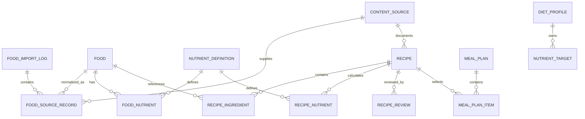

# RenalTable 데이터베이스 설계

- 상태: Phase 0 논리 설계
- DB: PostgreSQL
- 구현 예정: Phase 2

## 1. 모델링 원칙

- 식품 원 관측값과 레시피 계산값을 분리한다.
- 값의 부재와 숫자 0을 구분한다.
- 모든 영양값은 영양소, 값, 단위, 기준량, 데이터 상태, 출처를 함께 가진다.
- 원본 수집, 정규화, 검토, 게시를 서로 다른 상태로 추적한다.
- MVP의 `DietProfile`, `NutrientTarget`, `MealPlan`, `MealPlanItem`은 서버 테이블이 아니라 같은 개념의 브라우저 스키마로 구현한다. 향후 동기화 시 아래 논리 모델을 사용한다.

## 2. ERD

## 3. 핵심 테이블

### `content_source`

| 열 | 설명 |
| --- | --- |
| `id uuid PK` | 내부 식별자 |
| `publisher`, `title`, `url` | 출처 표시 |
| `source_type` | `FOOD_DB`, `GUIDELINE`, `RECIPE`, `OTHER` |
| `license_name`, `license_url` | 이용 조건 |
| `published_at`, `retrieved_at` | 원문/조회 시점 |
| `content_hash` | 원문 변경 탐지 |
| `status` | `ACTIVE`, `SUPERSEDED`, `UNAVAILABLE` |

### `food_import_log`

사용자 요구의 `FoodDataImportLog`에 해당한다.

| 열 | 설명 |
| --- | --- |
| `id uuid PK` | 수집 배치 |
| `source_id FK` | 데이터 출처 |
| `started_at`, `finished_at` | 실행 시간 |
| `status` | `FETCHED`, `VALIDATED`, `NEEDS_REVIEW`, `APPROVED`, `PUBLISHED`, `FAILED` |
| `schema_version`, `normalizer_version` | 변환 재현성 |
| `raw_object_uri`, `raw_sha256` | 불변 원본 위치/해시 |
| `record_count`, `accepted_count`, `rejected_count` | 품질 지표 |
| `error_summary`, `approved_by`, `approved_at` | 실패/승인 기록 |

원본 파일은 DB blob보다 접근이 제한된 객체 저장소 또는 개발용 파일에 보존하는 방안을 Phase 2에서 결정한다. 저장 위치와 보존 기간은 라이선스 확인 후 확정한다.

### `food_source_record`

원본 레코드와 정규화 결과의 연결이다. `source_id + external_id + source_revision`은 유일해야 한다. `raw_payload jsonb`는 원본 필드 추적용이며 공개 API에서 반환하지 않는다. 자동 중복 후보 점수와 사람의 병합 결정을 별도 열로 기록한다.

### `food`

| 열 | 설명 |
| --- | --- |
| `id uuid PK` | 안정적인 내부 ID |
| `canonical_name_ko` | 한국어 표준 표시명 |
| `category_code` | 내부 분류 코드 |
| `food_kind` | `RAW`, `PROCESSED`, `DISH` |
| `preparation_state` | 생것/삶음/구움 등; 모르면 `UNKNOWN` |
| `default_basis_amount`, `default_basis_unit` | 원자료 기준량 |
| `status` | `DRAFT`, `REVIEWED`, `PUBLISHED`, `RETIRED` |
| timestamps | 생성/수정/게시 시점 |

같은 이름이어도 조리 상태, 브랜드, 원산지, 기준량이 다르면 별도 식품으로 유지한다. 자동 병합하지 않는다.

### `nutrient_definition`

`code`는 안정적인 내부 키(`ENERGY`, `PROTEIN`, `SODIUM`, `POTASSIUM`, `PHOSPHORUS`, `WATER`)다. `canonical_unit`은 영양소마다 하나로 제한하고, 허용 변환 규칙과 표시 정밀도를 관리한다.

### `food_nutrient`

| 열 | 설명 |
| --- | --- |
| `food_id`, `nutrient_id` | 복합 식별의 일부 |
| `amount numeric NULL` | 관측값. 누락이면 NULL |
| `unit` | 원자료 단위 |
| `basis_amount`, `basis_unit` | 값의 기준량 |
| `value_status` | `PRESENT`, `TRACE`, `BELOW_LIMIT`, `MISSING`, `NOT_APPLICABLE` |
| `source_record_id` | 원본 계보 |
| `measured_at`, `source_updated_at` | 데이터 시점 |

제약:

- `PRESENT`일 때만 `amount IS NOT NULL AND amount >= 0`.
- `MISSING`일 때 `amount IS NULL`.
- 0은 출처가 실제 0으로 제공하고 `PRESENT`인 경우에만 허용한다.
- `(food_id, nutrient_id, source_record_id, basis_amount, basis_unit)` 유일성.

### `recipe`, `recipe_ingredient`

`recipe`는 제목, 소개, 인분, 식사 유형, 난이도, 조리 시간, 단계별 조리법, 알레르기 선언, 출처, 게시 상태를 가진다. `recipe_ingredient`는 순서, `food_id`, 원문 재료명, 수량, 단위, 먹는 부분 비율과 선택 여부를 가진다.

식재료가 내부 `food`에 연결되지 않거나 질량으로 변환할 수 없으면 영양 계산 상태를 불완전으로 만든다. 조리 수율·영양 보존율은 근거가 있는 경우에만 별도 버전 데이터로 적용한다.

### `recipe_nutrient`

재료에서 계산한 버전 있는 캐시다. `calculation_version`, `input_hash`, `calculated_at`, `completeness_status`, `missing_ingredient_count`를 저장한다. 수동 입력값으로 계산 결과를 덮어쓰지 않는다.

### `recipe_review`

| 열 | 설명 |
| --- | --- |
| `review_type` | `CULINARY`, `NUTRITION_DATA`, `MEDICAL_CONTENT` |
| `status` | `PENDING`, `CHANGES_REQUESTED`, `APPROVED`, `EXPIRED` |
| `reviewer_role` | 역할; 민감한 개인정보는 저장하지 않음 |
| `reviewed_at`, `expires_at` | 검토 유효기간 |
| `notes` | 구조화하기 어려운 검토 메모 |

필수 검토 유형이 모두 승인 상태인 레시피만 게시한다.

## 4. 브라우저 전용 논리 모델

### `diet_profile`

- `schemaVersion`
- `treatmentMode`: `UNSET | NON_DIALYSIS | HEMODIALYSIS | PERITONEAL_DIALYSIS`
- `targets[]`, `allergies[]`, `excludedIngredients[]`, `preferences[]`
- `updatedAt`

### `nutrient_target`

`nutrientCode`, `operator(MAXIMUM|MINIMUM|RANGE)`, `minValue?`, `maxValue?`, `unit`, `period(DAY)`, `source(USER_ENTERED_CLINICIAN_GUIDANCE)`, `updatedAt`를 가진다. 시스템 기본 목표는 만들지 않는다.

### `meal_plan`, `meal_plan_item`

주 시작일, 슬롯, 레시피 ID, 인분 수, 사용자 메모, 공개 데이터 버전을 저장한다. 서버 데이터가 변경되어도 기존 계산을 설명할 수 있도록 마지막 표시명과 계산 snapshot 또는 버전 키를 보존한다.

## 5. 정규화와 무결성

- 영양소 정의, 출처, 식품, 레시피를 분리한 3NF를 기본으로 한다.
- 레시피 계산 캐시는 성능과 계산 재현성을 위한 의도적 비정규화다.
- 공개 상태 전이는 application use case에서 검토 조건을 확인하고 DB transaction으로 처리한다.
- 외래키 삭제는 기본 `RESTRICT`; 기록 보존이 필요한 엔터티는 soft retirement를 사용한다.
- 금액/영양량은 `numeric`을 사용하며 부동소수점 반올림을 DB 진실값으로 저장하지 않는다.

## 6. 인덱스 초안

- `food(status, category_code, canonical_name_ko)`
- 한국어 검색용 `pg_trgm` GIN 인덱스는 실제 검색 품질/성능 측정 후 도입
- `food_nutrient(food_id, nutrient_id)` 및 `food_nutrient(nutrient_id, amount)` partial index (`value_status='PRESENT'`)
- `recipe(status, meal_type, difficulty, cooking_minutes)`
- `recipe_ingredient(recipe_id, position)`
- `food_source_record(source_id, external_id, source_revision)` unique
- `food_import_log(source_id, started_at DESC)`

## 7. 확장과 보류 결정

- 다국어 이름은 필요가 확인되면 `food_name` 별도 테이블로 분리한다.
- 사용자 계정 도입 전까지 서버용 프로필/식단 테이블과 RLS는 만들지 않는다.
- 변경 이력은 우선 append-only source record와 import log로 충족한다. 범용 audit table은 실제 요구 후 도입한다.
- 정확한 PostgreSQL/Supabase 버전과 extension 허용 범위는 Phase 2 연결 승인 시 확정한다.

